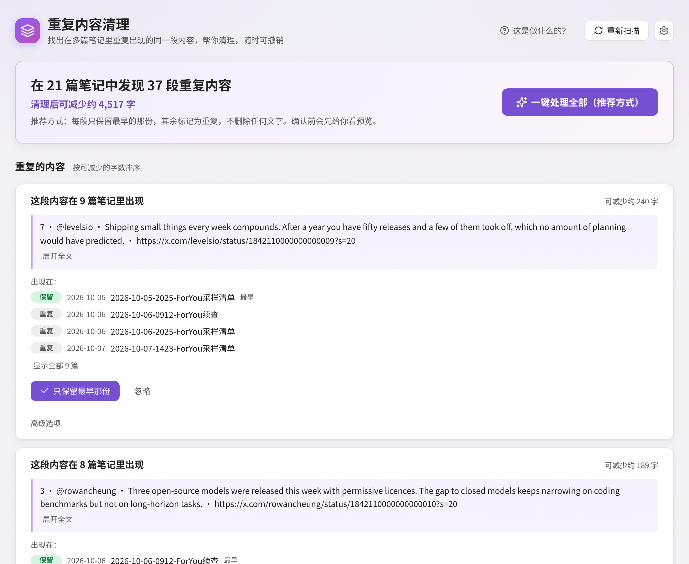
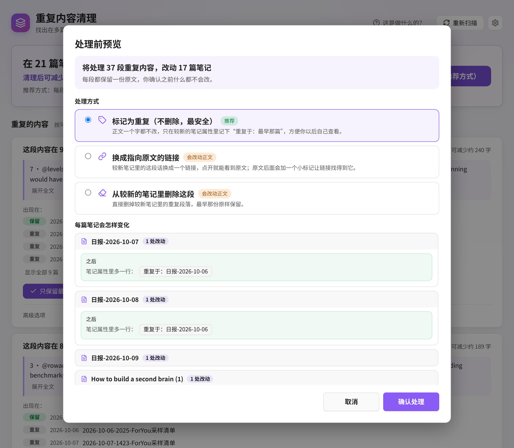
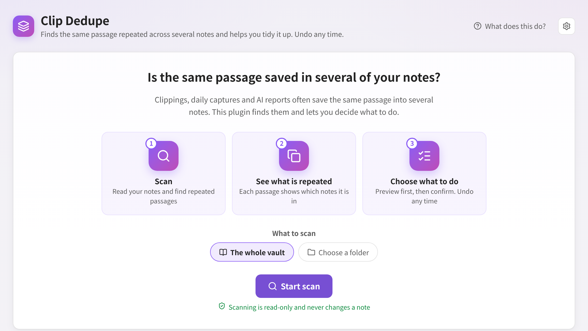
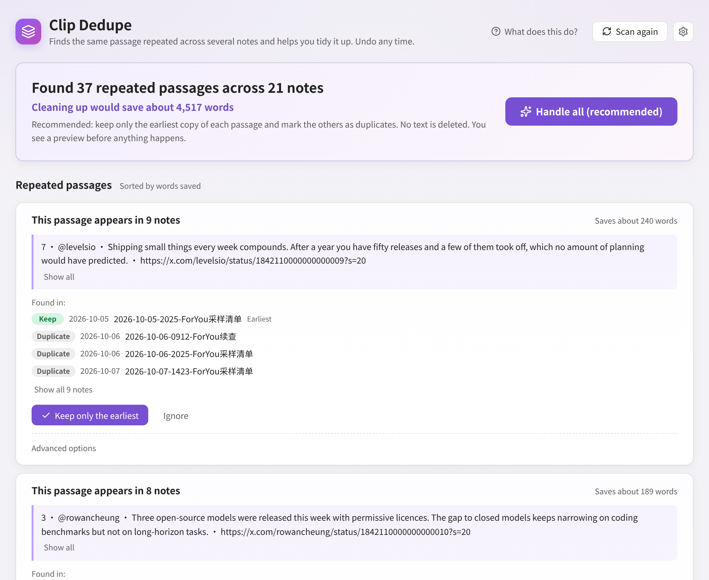

> [!IMPORTANT]
> **Clip Dedupe has been merged into [Note Pulse](https://github.com/FengBuL/note-pulse) (1.4.0+) as “Duplicate cleanup / 重复内容清理”.** New features and fixes land there. Install Note Pulse from Community plugins, then disable and remove Clip Dedupe; Note Pulse picks up your Clip Dedupe settings automatically.
>
> **Clip Dedupe 已并入 [Note Pulse](https://github.com/FengBuL/note-pulse)（1.4.0 起），名为“重复内容清理”。** 之后的更新都在 Note Pulse 里。从社区插件安装 Note Pulse 后，关闭并卸载 Clip Dedupe 即可，原来的设置会自动沿用。

# Clip Dedupe · 重复内容清理

[中文](#中文说明) · [English](#english)

---

## 中文说明

**找出在多篇笔记里重复出现的同一段内容，帮你只留一份。先预览，再确认，随时可撤销。**


### 它解决什么问题？

如果你经常剪藏网页、每天自动保存 X 推荐流、或者让 AI 每天生成日报，同一段话很容易被存进好几篇笔记。时间久了，搜索时一段话出来好几次，笔记库也越来越乱。

这个插件会读一遍你的笔记，告诉你：“**这段内容在 3 篇笔记里出现**”，然后由你决定怎么处理。

### 处理前后对比

假设三篇剪藏里都有同一段话：

| | 10月5日 剪藏 | 10月6日 剪藏 | 10月8日 剪藏 |
| --- | --- | --- | --- |
| **处理前** | 提示词缓存让费用降低了一半…… | 提示词缓存让费用降低了一半…… | 提示词缓存让费用降低了一半…… |
| **处理后（推荐方式）** | 原样保留 | 正文不变，属性里多一行 `duplicate_of: [[10月5日 剪藏]]` | 正文不变，属性里多一行 `duplicate_of: [[10月5日 剪藏]]` |

最早的那份永远原样保留。

### 怎么用

1. 点左侧边栏的图标，或在命令面板里运行 **查找重复内容**。
2. 选择扫描范围（整个笔记库或某个文件夹），点 **开始扫描**。扫描只读，不会改动任何笔记。
3. 结果页第一句话就告诉你：在几篇笔记里发现了几段重复内容、清理后能少多少字。
4. 每一段都可以点 **只保留最早那份**，或者 **忽略**。想一次处理完，点 **一键处理全部（推荐方式）**。
5. 预览窗口会逐篇列出“之前 / 之后”，点 **确认处理** 才会改。
6. 处理完会弹出提示，里面就有 **撤销** 按钮；之后也可以随时点页面顶部的 **撤销上一次处理**。





### 三种处理方式

| 方式 | 会发生什么 |
| --- | --- |
| **标记为重复（不删除，最安全，默认）** | 正文一个字都不改，只在较新的笔记属性里记下它重复了哪一篇 |
| **换成指向原文的链接** | 较新笔记里的这段话换成指向原文的链接（或嵌入），原文末尾加一个小标记 |
| **从较新的笔记里删除这段** | 直接删掉较新笔记里的重复段落，最早那份保留 |

后两种会改正文，预览里需要再勾选一次确认。每次处理前都会自动备份。

### 设置

- **基础**：只扫描哪些文件夹、不要扫描哪些文件夹、忽略太短的段落（默认少于 80 个字符，约 40 个汉字）。
- **高级**：是否比较属性、代码块、标题；同一条 X 帖子是否算重复；默认保留哪一份；默认处理方式；备份数量等。

不懂的设置保持默认就好。

### 安装

1. 从 [最新发布页](https://github.com/FengBuL/clip-dedupe/releases/latest) 下载 `main.js`、`manifest.json`、`styles.css`。
2. 放到 `<你的库>/.obsidian/plugins/clip-dedupe/`。
3. 重启 Obsidian，在 **设置 → 第三方插件** 里启用 **Clip Dedupe**。

### 需要知道的限制

- 只能找出“一模一样”的段落（会忽略大小写、空格和 Markdown 符号）。换了说法的重复找不到。
- 表格行和代码块不能换成链接。
- 已经在模拟数据和单元测试里测过，但第一次用建议先选一个文件夹试试。

更多截图：[深色](docs/zh-results-dark.png) · [删除方式的预览](docs/zh-preview-modal-delete-dark.png) · [“这是做什么的？”](docs/zh-help-light.png) · [窄屏欢迎页](docs/zh-narrow-welcome-light.png) · [窄屏结果页](docs/zh-narrow-results-dark.png)

---

## English

**Finds the same passage repeated across several of your notes and helps you keep just one copy. Preview first, confirm, undo any time.**



### What problem does it solve?

Web clippings, daily captures and AI-generated reports often save the same passage into several notes. Over time search shows it again and again and the vault gets messy. Clip Dedupe reads your notes and tells you “**this passage appears in 3 notes**”. You decide what to do.

### Before and after

| | Oct 5 clipping | Oct 6 clipping | Oct 8 clipping |
| --- | --- | --- | --- |
| **Before** | Prompt caching cut our bill by half… | Prompt caching cut our bill by half… | Prompt caching cut our bill by half… |
| **After (recommended)** | Kept as is | Text unchanged, gets `duplicate_of: [[Oct 5 clipping]]` | Text unchanged, gets `duplicate_of: [[Oct 5 clipping]]` |

The earliest copy is always kept untouched.

### How to use it

1. Click the ribbon icon or run **Find duplicate content**.
2. Pick what to scan (the whole vault or one folder) and press **Start scan**. Scanning is read-only.
3. The results start with one sentence: how many repeated passages were found in how many notes, and how much you would save.
4. For each passage press **Keep only the earliest** or **Ignore**. Or press **Handle all (recommended)**.
5. The preview shows before and after for every note. Nothing changes until you press **Confirm**.
6. A notice with an **Undo** button appears afterwards, and **Undo last cleanup** stays at the top of the page.



### Three ways to handle a duplicate

- **Mark as duplicate (default, deletes nothing)**: adds a `duplicate_of` property to the newer notes.
- **Replace with a link to the original**: the passage in newer notes becomes a link or embed; the original gets a small block id.
- **Delete it from the newer notes**: removes the passage from newer notes; the earliest copy stays.

The last two change text and ask for one more confirmation. Every cleanup is backed up first.

### Settings

- **Basics**: folders to scan, folders to skip, and the minimum passage length (80 characters by default; Han characters count two).
- **Advanced**: properties, code, headings, link-only passages, X post matching, which copy to keep, default way, link style, property name, backups, cache.

### Installation

Download `main.js`, `manifest.json` and `styles.css` from the [latest release](https://github.com/FengBuL/clip-dedupe/releases/latest) into `<vault>/.obsidian/plugins/clip-dedupe/`, reload Obsidian and enable **Clip Dedupe**.

### Limitations

- Only exact repeats are found (case, whitespace and Markdown markup are ignored). Paraphrases are not.
- Table rows and code blocks cannot be replaced with links.
- Tested with synthetic notes and unit tests. Try it on one folder first.

### Development

```bash
npm install
npm run verify   # typecheck, lint, unit tests, CSS check, production build
```

Screenshots are rendered with mock data by `scripts/preview/build.sh` and `scripts/preview/shot.cjs`.

## License

MIT
