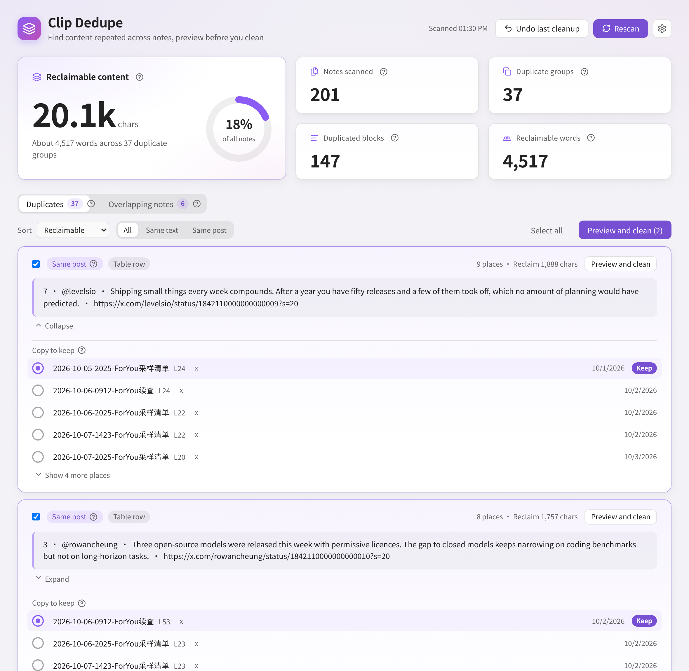
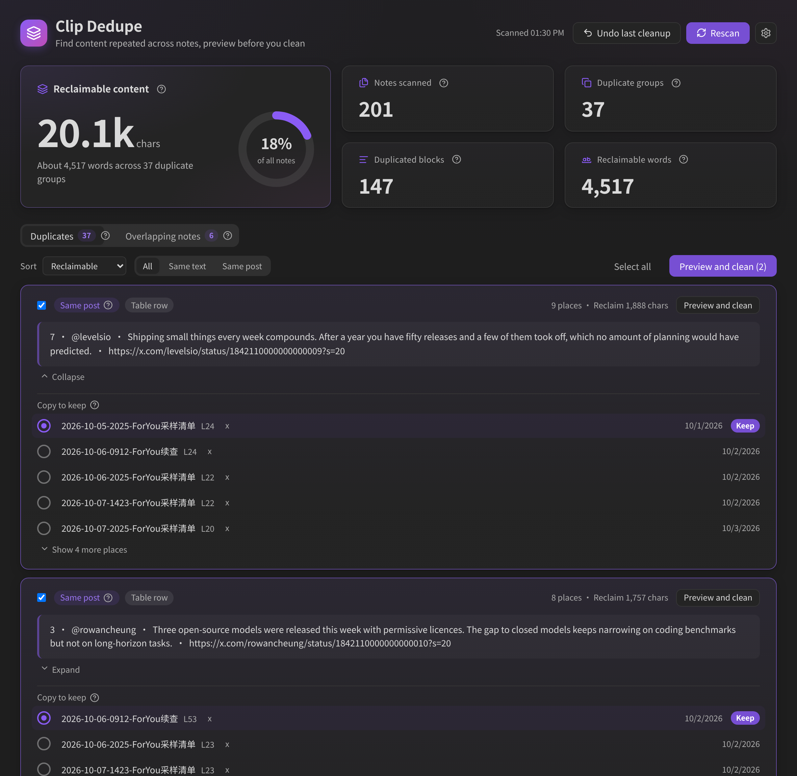
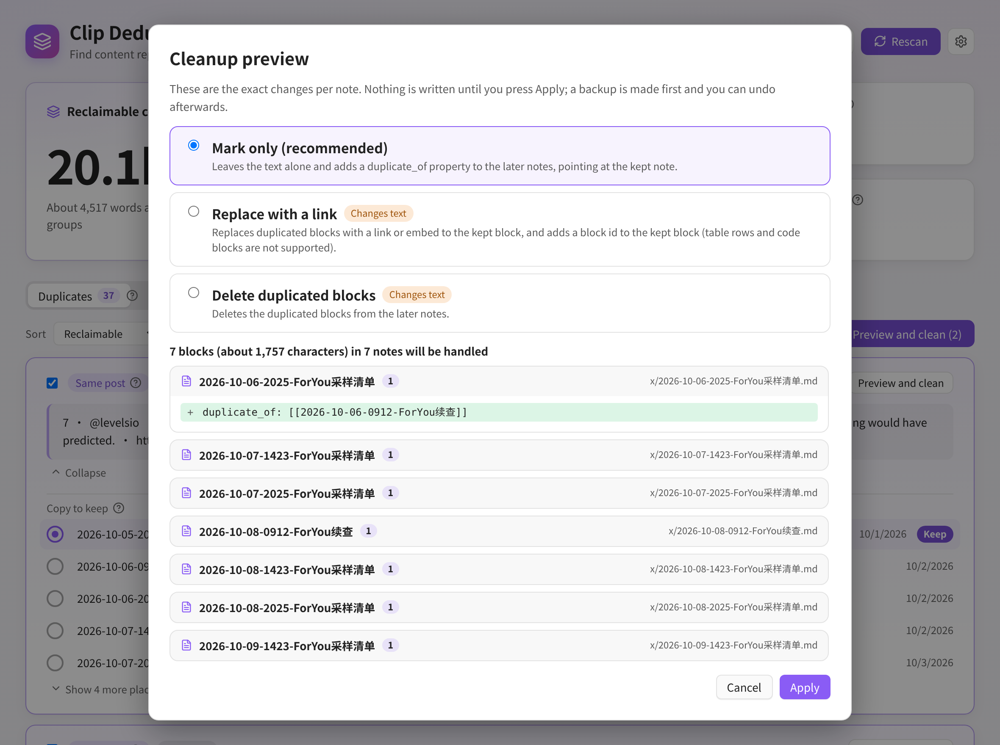
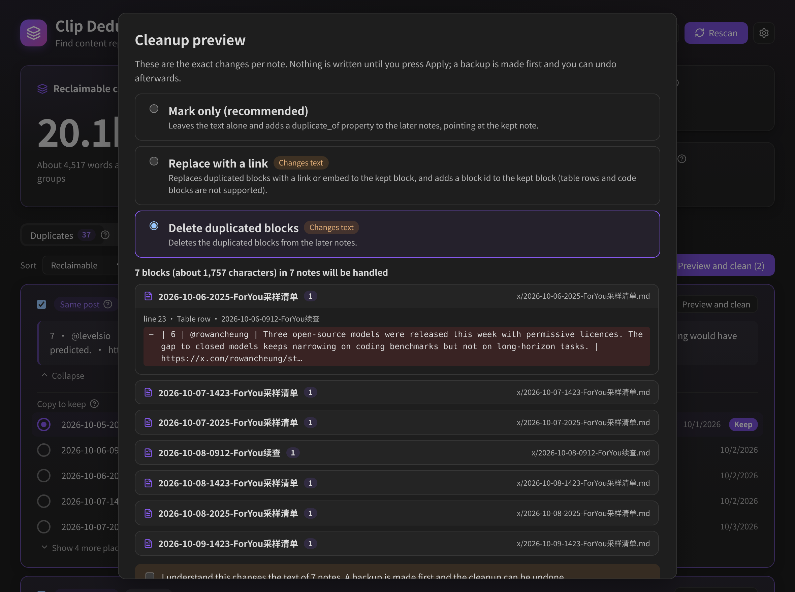
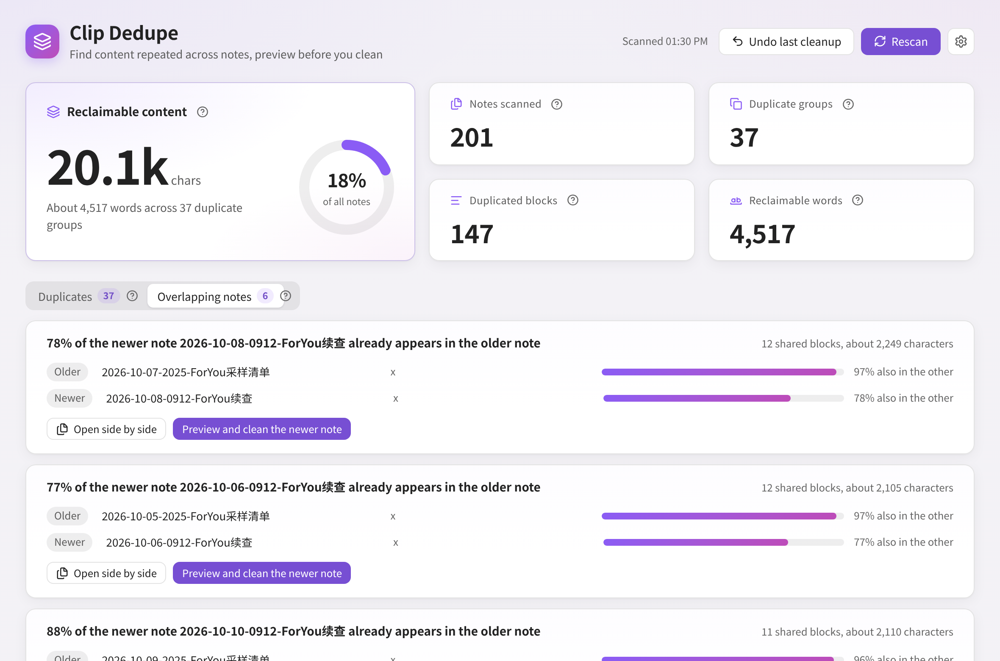
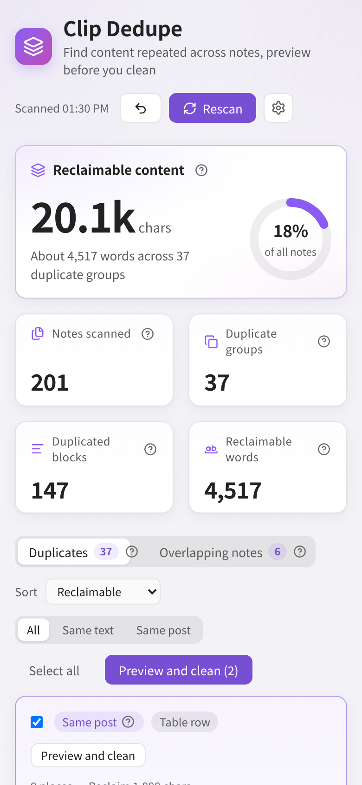
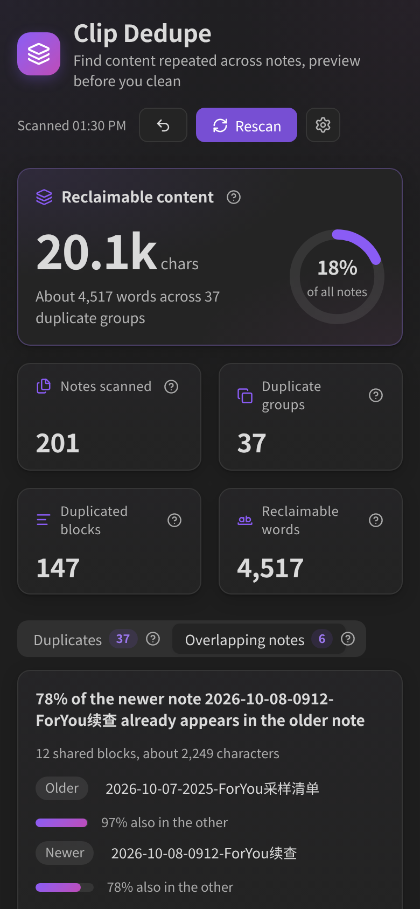
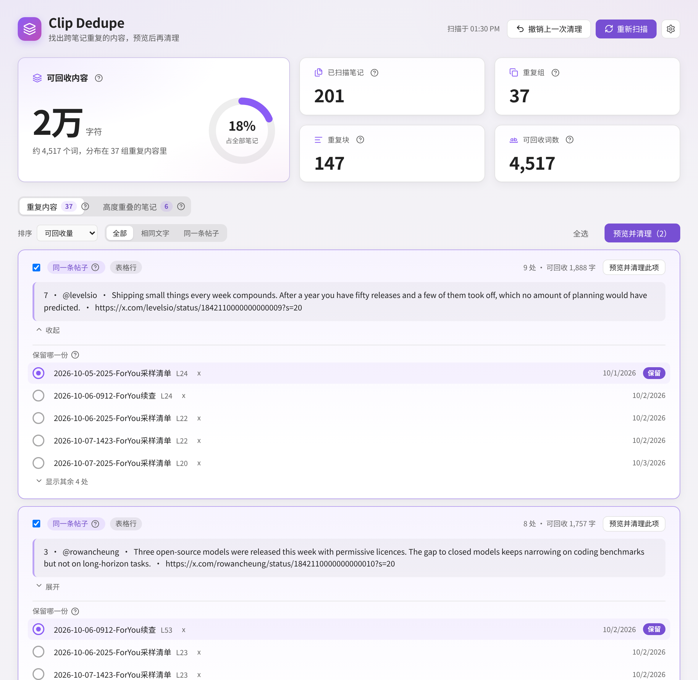
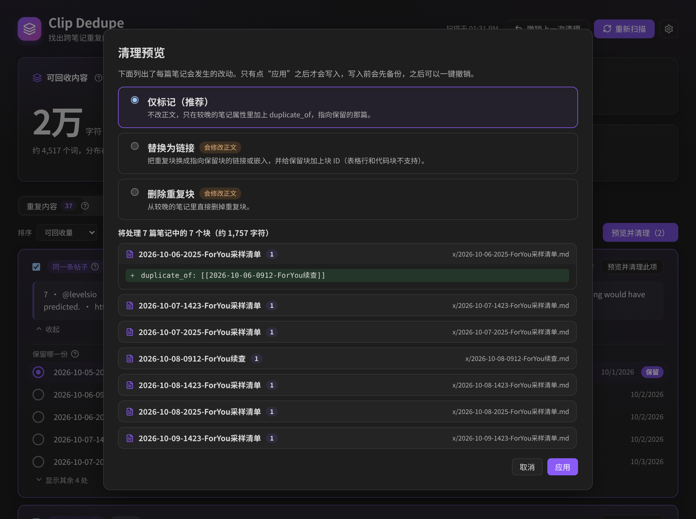

# Clip Dedupe

**English** | [中文](#中文说明)

Clip Dedupe is an [Obsidian](https://obsidian.md) plugin that finds content repeated **across notes** and helps you clean it up safely.

It is made for vaults that fill up by themselves: web clippings, daily "For You" dumps, follow-up notes that re-include the previous run, AI reports that repeat the same paragraphs. Other duplicate tools compare whole notes by similarity, or look for repeated lines inside one note. Clip Dedupe works on **blocks** (paragraphs, list items, table rows, quotes) and tells you exactly where each one is repeated.



<details>
<summary>Dark theme, cleanup preview, overlapping notes and narrow layout</summary>









 

</details>

> Screenshots are rendered with sample data.

## What it does

- **Scans** the whole vault or only the folders you choose and splits every note into blocks: paragraphs, list items (with their children), table rows and blockquotes.
- **Matches** blocks on normalised text: Markdown markup, case, whitespace and URL tracking parameters (`utm_*`, `s=`, `t=`, …) are ignored, and Chinese, Japanese and Korean text is handled (the same paragraph reflowed differently still matches). `x.com` and `twitter.com` links are treated as the same.
- **Groups by X post.** Blocks that link the same `/status/<id>` are shown as "same post", even if the surrounding text differs.
- **Reports** summary cards (notes scanned, duplicate groups, duplicated blocks, reclaimable words and characters, share of your notes), a ranked list of groups, where each one appears (click to open the note at that line), and which copy to keep.
- **Finds overlapping notes**, such as a follow-up note that is 85% contained in an older one.
- **Cleans up with a preview, a backup and undo.**

## Cleanup and the safety model

Nothing is written until you press **Apply** in the preview window, which lists exactly which blocks change in which notes.

| Mode | What it does | Changes note text |
| --- | --- | --- |
| **Mark only** (default) | Adds a `duplicate_of` property (a link to the kept note) to the later notes | No |
| **Replace with a link** | Replaces the duplicate block with `![[note#^id]]` (or a plain link) and adds a block id to the kept block. Table rows and code blocks are not supported | Yes |
| **Delete** | Removes the duplicate block from the later notes | Yes |

- The two modes that change text need an extra confirmation checkbox.
- By default the **earliest** copy is kept (the date in the file name such as `2026-10-05-…`, otherwise the creation time). You can change it per group, or the default in settings.
- Before any change the plugin saves the original text of every note it will touch to `.obsidian/plugins/clip-dedupe/backups/` (the last 10 are kept by default).
- **Undo** (command or button in the report) restores the notes. If you edited a note after the cleanup, that note is **not** overwritten; it is skipped and listed.
- Edits use `Vault.process` and `processFrontMatter`, so they are atomic and cooperate with other plugins. A note is checked against what was scanned right before the write; if it changed since, it is skipped. Notes modified in the last 2 seconds (for example by iCloud sync) are never touched.
- Deleting table rows could leave a table without its header; the plan keeps the header or skips that row.

## Installation

### From Community plugins

Not listed yet. The submission is pending, so use the manual installation for now.

### Manual

1. Download `main.js`, `manifest.json` and `styles.css` from the [latest release](https://github.com/FengBuL/clip-dedupe/releases/latest).
2. Put them in `<your vault>/.obsidian/plugins/clip-dedupe/`.
3. Reload Obsidian and enable **Clip Dedupe** under **Settings → Community plugins**.

## Usage

1. Click the layers icon in the ribbon, or run **Scan for duplicate content** from the command palette.
2. Look through the groups. Pick which copy to keep if the default is not right.
3. Select groups and press **Preview and clean**, or use **Preview and clean** on a single group or a pair of overlapping notes.
4. Choose a mode, read the preview and press **Apply**.
5. Changed your mind? Run **Undo the last cleanup**.

Commands: **Scan for duplicate content**, **Open duplicate report** (without scanning), **Undo the last cleanup**.

## Settings

| Setting | Description |
| --- | --- |
| Included / excluded folders | Which notes take part. Excluded wins |
| Minimum block length | Shorter blocks are ignored. Han characters count two, so the default 80 is about 40 Han characters |
| Ignore frontmatter, code blocks, headings, link-only blocks | On by default |
| Group by X post id | Blocks with the same status id are "same post" (ignores the minimum length) |
| Copy to keep by default | Auto (file name date, then created time), created, modified or file name |
| Overlap threshold | How much of a note must appear in another to be listed (default 70%) |
| Default cleanup mode, replace style, marker property name | Defaults for the preview window |
| Backups to keep | Default 10 |
| Open notes in a new tab | Keep the report open when you click a note |
| Clear scan cache | Forces the next scan to read every note again |

The interface follows Obsidian's language: Chinese when it is set to a Chinese language, English otherwise.

## Performance

A scan reads notes in small batches and yields to the interface, shows progress and can be cancelled. The fingerprints of every note are cached by modified time in `cache.json` inside the plugin folder (separate from settings), so a rescan only reads notes that changed. In a synthetic test with 10,000 notes (28 MB, 160k blocks), tokenising took about 3 seconds on a desktop and grouping took under 0.2 seconds; later scans skip the unchanged notes.

## Limitations

- Matching is exact after normalisation (plus the X post id rule). Paraphrased text, or the same sentence inside a longer paragraph, is not detected.
- Blocks are paragraphs, list items, table rows and quotes. Headings and code are skipped by default, and a list item with children is one block.
- "Replace with a link" does not support table rows or code blocks, and a note that is being edited elsewhere (or just changed) is skipped.
- Links to a removed block that pointed at the deleted copy are not rewritten.
- The "keep" choice is made per group; there is no rule engine.
- The plugin has been tested with synthetic notes and unit tests, not on every vault layout. **Try it on a copy first** and use the preview.

## Development

```bash
npm install
npm run verify   # typecheck, lint, unit tests, CSS check, production build
npm run dev
```

Screenshots are rendered by `scripts/preview/build.sh` and `scripts/preview/shot.cjs` (headless Chrome with mock data).

## License

MIT

---

# 中文说明

Clip Dedupe 是一个 [Obsidian](https://obsidian.md) 插件，用来找出**跨笔记**重复的内容，并安全地清理。

它面向会“自己长大”的库：网页剪藏、每天保存的“为你推荐”清单、把上一次内容又带进来的续查笔记、反复出现同样段落的 AI 报告。现有的重复检测要么按整篇相似度比较，要么只看单篇里重复的行。Clip Dedupe 以**块**（段落、列表项、表格行、引用）为单位，告诉你每一块在哪些笔记里重复出现。





> 截图使用示例数据渲染。

## 功能

- **扫描**整个仓库或指定文件夹，把每篇笔记拆成块：段落、列表项（含子项）、表格行、引用。
- **匹配**基于规范化后的文字：忽略 Markdown 标记、大小写、空白和链接里的跟踪参数（`utm_*`、`s=`、`t=` 等），对中日韩文字做了处理（同一段落换行不同也能匹配），`x.com` 和 `twitter.com` 视为同一个。
- **按 X 帖子归组**：链接了同一个 `/status/<id>` 的块算“同一条帖子”，即使周围文字不同。
- **报告**：已扫描笔记、重复组、重复块、可回收词数和字符、占全部笔记的比例；按可回收量排序的重复组；每组出现在哪些笔记里（点击跳到对应行）；保留哪一份。
- **高度重叠的笔记**：例如一篇续查笔记有 85% 的内容已出现在较旧的笔记里。
- **预览、备份、撤销**的清理流程。

## 清理与安全

在预览窗口点“应用”之前不会写入任何内容，预览会列出每篇笔记里具体改哪几块。

| 方式 | 做什么 | 是否改正文 |
| --- | --- | --- |
| **仅标记**（默认） | 在较晚的笔记属性里加 `duplicate_of`（指向保留的笔记） | 否 |
| **替换为链接** | 把重复块换成 `![[笔记#^id]]`（或普通链接），并给保留块加块 ID。不支持表格行和代码块 | 是 |
| **删除重复块** | 从较晚的笔记里删掉重复块 | 是 |

- 会改正文的两种方式需要额外勾选确认。
- 默认保留**最早**的一份（文件名里的日期，如 `2026-10-05-…`，没有则看创建时间），可以每组单独改，也可以在设置里改默认。
- 任何改动之前，会把要改的每篇笔记的原文备份到 `.obsidian/plugins/clip-dedupe/backups/`，默认保留最近 10 次。
- **撤销**（命令或报告里的按钮）会还原笔记。如果清理之后你又编辑过某篇笔记，这篇不会被覆盖，会被跳过并列出来。
- 写入用 `Vault.process` 和 `processFrontMatter`，是原子操作；写入前会核对笔记仍和扫描时一致，不一致就跳过；2 秒内刚被修改的笔记（比如 iCloud 刚同步）不会被碰。
- 删除表格行可能让表格丢表头，计划会保留表头或跳过该行。

## 安装

### 官方插件市场

暂未上架（已提交，等待审核）。目前请手动安装。

### 手动安装

1. 从[最新发布](https://github.com/FengBuL/clip-dedupe/releases/latest)下载 `main.js`、`manifest.json`、`styles.css`。
2. 放到 `<你的库>/.obsidian/plugins/clip-dedupe/`。
3. 重载 Obsidian，在**设置 → 第三方插件**里启用 **Clip Dedupe**。

## 使用

1. 点左侧栏的图层图标，或在命令面板运行“扫描重复内容”。
2. 浏览各个重复组，需要的话改保留哪一份。
3. 勾选若干组后点“预览并清理”，也可以对单个组或一对重叠笔记点“预览并清理”。
4. 选择方式，看预览，点“应用”。
5. 后悔了就运行“撤销上一次清理”。

命令：**扫描重复内容**、**打开重复内容报告**（不重新扫描）、**撤销上一次清理**。

## 设置

范围（包含 / 排除文件夹）、最短块长度（汉字算两个字符，默认 80 约 40 个汉字）、是否忽略属性区 / 代码块 / 标题 / 只有链接的块、按 X 帖子 ID 归组、默认保留哪一份、重叠阈值（默认 70%）、默认清理方式、替换时用嵌入还是链接、标记属性名、保留的备份数量、是否在新标签页打开、清除扫描缓存。界面语言跟随 Obsidian：中文环境显示中文，否则英文。

## 性能

扫描分批读取并让出界面，显示进度，可以取消。每篇笔记的指纹按修改时间缓存在插件目录的 `cache.json`（与设置分开），重新扫描只读改动过的笔记。在 1 万篇笔记（28 MB，16 万个块）的合成测试里，拆分约 3 秒，归组不到 0.2 秒，之后的扫描会跳过未改动的笔记。

## 限制

- 只做规范化后的精确匹配（加 X 帖子 ID 规则），改写过的文字、或嵌在更长段落里的同一句话检测不到。
- 块是段落、列表项、表格行和引用；标题和代码默认跳过；带子项的列表项算一个块。
- “替换为链接”不支持表格行和代码块；正在被编辑或刚被修改的笔记会被跳过。
- 指向被删除那一份的块链接不会被改写。
- 保留哪一份按组选择，没有规则引擎。
- 目前只在合成笔记和单元测试里验证过。**请先在副本上试用**，并看预览。

## 许可证

MIT
